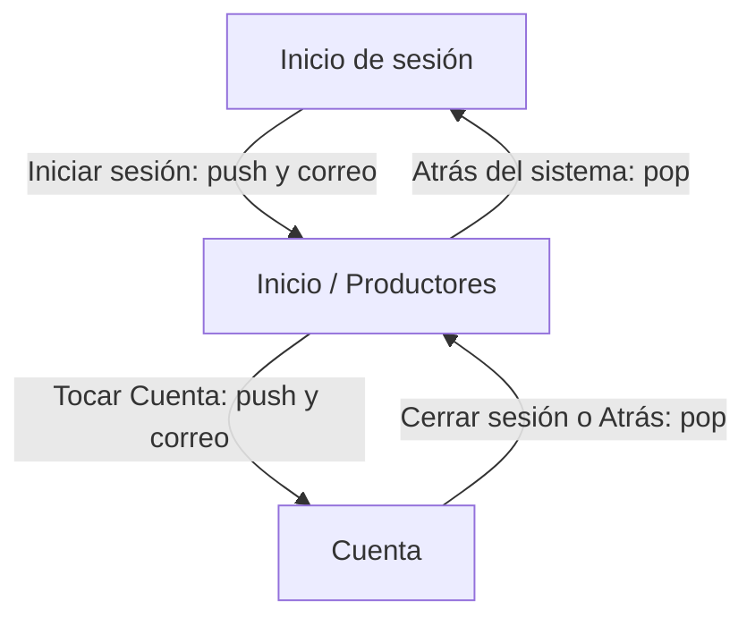

# Mercado Campesino

Aplicación móvil desarrollada en Flutter para consultar productores campesinos.
Los datos de ejemplo viven en el código; no se usa API ni base de datos.

## Integrantes y pantallas

Vanessa realiza individualmente las tres pantallas de este flujo: Inicio de
sesión, Inicio y Cuenta. La actividad plantea un equipo de tres personas; la
adaptación individual debe confirmarse con la docente.

## Flujo diseñado

## Tabla de navegación

| Desde | Hacia | Acción del usuario | Método | ¿Por qué? | Datos que viajan | Pila después del salto |
|---|---|---|---|---|---|---|
| Inicio de sesión | Inicio | Escribe el correo y toca "Iniciar sesión" | `Navigator.push` | Abre la pantalla principal conservando el inicio de sesión debajo para que Atrás funcione como retorno. | El correo, recibido por el constructor de Inicio y mostrado en el saludo. | Inicio de sesión → Inicio |
| Inicio | Cuenta | Toca "Cuenta" en la navegación inferior | `Navigator.push` | Permite consultar la cuenta y volver a Inicio sin reemplazarlo. | El mismo correo, recibido por el constructor de Cuenta y mostrado en pantalla. | Inicio de sesión → Inicio → Cuenta |
| Cuenta | Inicio | Toca "Cerrar sesión" o Atrás del sistema | `Navigator.pop` | Regresa a la pantalla anterior y retira Cuenta de la pila. | No se envían datos nuevos. | Inicio de sesión → Inicio |
| Inicio | Inicio de sesión | Toca "Cerrar sesión" o presiona Atrás del sistema | `Navigator.pop` | Retira Inicio y vuelve a la pantalla que lo abrió, con un botón y con el retorno del sistema. | No se envían datos nuevos. | Inicio de sesión |

## Decisiones

- Se eligió la combinación recomendada Inicio de sesión, Inicio y Cuenta para
     limitar el flujo a tres pantallas y reutilizar la pantalla de productores.
- Se usa `push` en ambos avances para conservar la pantalla anterior; `pop`
     permite volver y hace observable el comportamiento de la pila.
- El correo se captura en el inicio de sesión y se pasa explícitamente por
     constructores. No hay autenticación real ni validación de campos en esta
     actividad.
- Los destinos que no pertenecen a este flujo no se implementan; los controles
     de navegación ajenos a las tres pantallas quedan sin acción o se omiten.

## Cambios respecto al diseño anterior

El primer borrador incluía Registro, Productos, Detalle de producto, Carrito y
Confirmación. Antes de implementar la navegación se redujo al trío recomendado
Inicio de sesión, Inicio y Cuenta, para que el diagrama, la tabla y el código
describan el mismo alcance.

## Ayudas usadas

- Guía de la actividad de navegación de Semana 5: requisitos, pantallas,
     navegación, evaluación y sustentación.
- GitHub Copilot: análisis de requisitos, actualización de este diseño e
     implementación. Vanessa revisará y debe poder explicar cada parte del código.