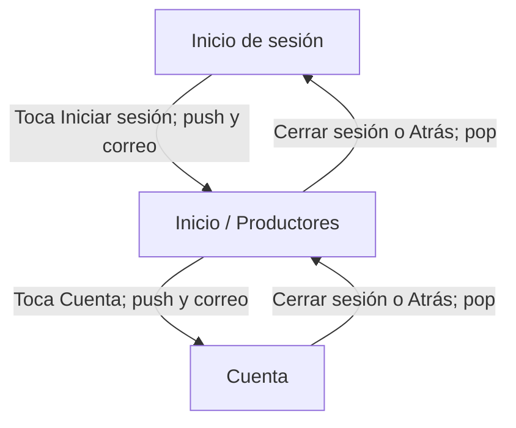

# Mercado Campesino

Aplicación móvil Flutter con datos fijos en el código para demostrar navegación
entre pantallas y transferencia de datos mediante constructores.

## Integrante y pantallas

La autora realiza individualmente las tres pantallas de este flujo: Inicio de
sesión, Inicio (lista de productores) y Cuenta. La actividad propone un equipo
de tres; esta adaptación individual debe ser confirmada con la docente. Por ese
motivo, este repositorio no representa tres integrantes ni revisiones de Pull
Request entre compañeros.

## Flujo diseñado

## Tabla de navegación

| Desde | Hacia | Acción del usuario | Método | ¿Por qué? | Datos que viajan | Pila después del salto |
|---|---|---|---|---|---|---|
| Inicio de sesión | Inicio | Escribe el correo y toca "Iniciar sesión" | `Navigator.push` | Abre la lista de productores y conserva el login debajo para poder regresar con Atrás. | El correo, recibido por el constructor de Inicio y mostrado en el saludo. | Inicio de sesión → Inicio |
| Inicio | Cuenta | Toca "Cuenta" en la barra inferior | `Navigator.push` | Abre la cuenta y conserva Inicio debajo para regresar sin reconstruir la lista. | El correo, recibido por el constructor de Cuenta y mostrado en pantalla. | Inicio de sesión → Inicio → Cuenta |
| Cuenta | Inicio | Toca "Cerrar sesión" o Atrás del sistema | `Navigator.pop` | Retira Cuenta de la pila y regresa a Inicio. | No se envían datos nuevos. | Inicio de sesión → Inicio |
| Inicio | Inicio de sesión | Toca el botón de salida o Atrás del sistema | `Navigator.pop` | Retira Inicio y regresa a la pantalla anterior. | No se envían datos nuevos. | Inicio de sesión |

## Decisiones

- Se eligió la combinación recomendada Inicio de sesión, Inicio y Cuenta, que
     permite practicar el paso de datos de ida y el retorno con `pop`.
- Se usa `push` en los avances para conservar la pantalla anterior en la pila;
     los regresos usan `pop`, tanto desde botones como desde Atrás del sistema.
- El correo se pasa explícitamente por constructores. El nombre de Cuenta y los
     productores son datos de ejemplo escritos en el código.
- No hay autenticación real ni validación de los campos, de acuerdo con el
     alcance de la actividad. Las opciones Pedidos y Favoritos no navegan porque
     sus destinos no forman parte de las tres pantallas elegidas.

## Cambios respecto al diseño anterior

El borrador anterior describía Registro, Productos, Detalle de producto,
Carrito y Confirmación, pero esas pantallas y saltos no están implementados.
Se retiraron del diseño final para que el diagrama y la tabla correspondan al
flujo que sí existe en el código: Inicio de sesión → Inicio → Cuenta.

## Ayudas usadas

- Guía de la actividad de navegación de Semana 5: requisitos, pantallas,
     navegación, evaluación y sustentación.
- GitHub Copilot: apoyo para analizar la guía, organizar la documentación y
     desarrollar y verificar el flujo. La autora debe poder explicar y modificar
     el código durante la sustentación.